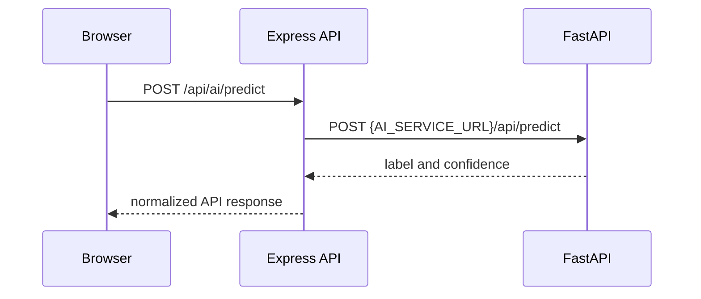

# Chapter 2: A Platform Split Across Service Boundaries

CyberShield uses a React and Vite client, an Express API, MongoDB persistence, and a separate FastAPI service for text classification. The API also owns authentication, authorization, reporting, moderation, policy enforcement, and TrustScan orchestration.

This split gives the AI component an independent runtime and deployment boundary. It also creates an ordinary but unforgiving distributed-systems problem: the frontend, API, and AI service must agree on where the next request goes, what contract it speaks, and what happens when a dependency is unavailable.

## Request path

The frontend is expected to call the backend through a configured API base URL. The backend AI adapter posts text to `AI_SERVICE_URL` plus `/api/predict`. The FastAPI application mounts its prediction router under `/api`, so the service route is `POST /api/predict`.

The adapter catches downstream request errors and returns a generic “AI service failed” error. This keeps the caller from depending on the raw Axios error, but the actual service address still has to be correct. Environment-based configuration is only useful when deployment configuration matches the service topology.

## The deployment seam

The deployment guide describes separate Vercel and Render services and requires the frontend to point at the intended backend, the backend to reach the AI service, and health checks and smoke tests to run after deployment. Those are release checks, not evidence that they have been completed for every current deployment.

The source's root README and environment examples include local development addresses. Such values are not intrinsically wrong; they are wrong when carried into a deployment where localhost refers to the API container itself rather than the AI service. This is a configuration boundary to verify, not a detail to paper over in the story.

## The planned worker is still planned

The system-design and TrustScan architecture documents describe a dedicated worker, queue transport, Redis-backed deduplication/cache, retries, and worker scaling as future direction. In the reviewed controller, TrustScan execution is still driven through the status-polling completion path. A diagram that draws a worker as if it already runs would convert an architecture proposal into fiction, which is an avoidable genre.

**Sources:** [System design](https://github.com/Mystify7777/CyberShield/blob/740a612024491ecfb0df19f869a02be68d2f55b7/docs/engineering/SYSTEM_DESIGN.md), [deployment guide](https://github.com/Mystify7777/CyberShield/blob/740a612024491ecfb0df19f869a02be68d2f55b7/docs/ops/DEPLOYMENT.md), [AI adapter](https://github.com/Mystify7777/CyberShield/blob/740a612024491ecfb0df19f869a02be68d2f55b7/server/src/services/aiService.js), [FastAPI route](https://github.com/Mystify7777/CyberShield/blob/740a612024491ecfb0df19f869a02be68d2f55b7/ai-service/app/routes/predict.py), [TrustScan controller](https://github.com/Mystify7777/CyberShield/blob/740a612024491ecfb0df19f869a02be68d2f55b7/server/src/controllers/trustScanController.js).
