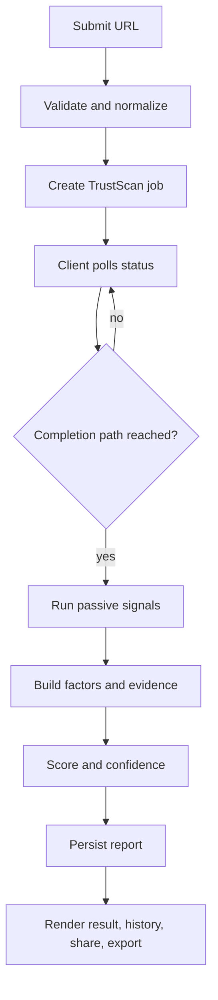

# Chapter 3: TrustScan, Useful Evidence Without Intrusive Scanning

TrustScan starts with a URL and aims to produce a report a non-specialist can inspect. Its documented pipeline is: normalize the target, create a job, poll status, run passive checks in the completion path, persist the results, then present a scorecard and explanation. Users can view authenticated history and a public read-only report.

The signal families are deliberately varied:

- **TLS and certificate state:** transport-security evidence.
- **HTTP security headers:** browser-facing hardening signals.
- **DNS and domain intelligence:** resolution and available registration/infrastructure context.
- **Public reputation:** whether an external reputation source has a listing for the target.

The controller converts raw signal outputs into factor objects and evidence events, then persists a report with the score, verdict, confidence, factors, summary, timing, and scan metadata. The UI has dedicated components for confidence, evidence timeline, headers, reputation, domain details, score ring, and report actions. The architecture is therefore not just a score calculation. It has a data path intended to show the evidence behind that score.

## A lifecycle with a real limitation

The docs describe a job lifecycle of queued, running, completed, or failed. The implementation creates a job and advances it when the status endpoint is polled; the dedicated worker is a planned future change. That design can make the user-facing interaction asynchronous without yet providing independent background execution. Polling is doing more than reading status in the current implementation.

## Safety is part of the pipeline

The policy says prohibited targets must be rejected before execution, scans must be passive, and abuse-sensitive paths must be throttled. These are requirements that should be checked in implementation and release tests. The product spec also calls out malformed URLs, denied targets, slow scans, status accuracy, public report access, and PDF export as QA scenarios.

## Caching and deduplication

The controller includes a ten-minute in-memory report cache keyed by a lowercased URL and uses persisted report/job lookups as part of the scan flow. The changelog also records a five-scans-per-hour user limit and duplicate scan deduplication. An in-memory cache is process-local: it does not become shared coordination across multiple server instances simply because it has a TTL. That distinction matters when describing reliability and scaling.

**Sources:** [TrustScan architecture](https://github.com/Mystify7777/CyberShield/blob/740a612024491ecfb0df19f869a02be68d2f55b7/docs/engineering/TRUSTSCAN_ARCHITECTURE.md), [policy](https://github.com/Mystify7777/CyberShield/blob/740a612024491ecfb0df19f869a02be68d2f55b7/docs/security/TRUSTSCAN_POLICY.md), [controller](https://github.com/Mystify7777/CyberShield/blob/740a612024491ecfb0df19f869a02be68d2f55b7/server/src/controllers/trustScanController.js), [TrustScan routes](https://github.com/Mystify7777/CyberShield/blob/740a612024491ecfb0df19f869a02be68d2f55b7/server/src/routes/trustScanRoutes.js), [report UI](https://github.com/Mystify7777/CyberShield/blob/740a612024491ecfb0df19f869a02be68d2f55b7/client/src/pages/trustscan/TrustScanReport.jsx), [changelog](https://github.com/Mystify7777/CyberShield/blob/740a612024491ecfb0df19f869a02be68d2f55b7/docs/CHANGELOG.md).
