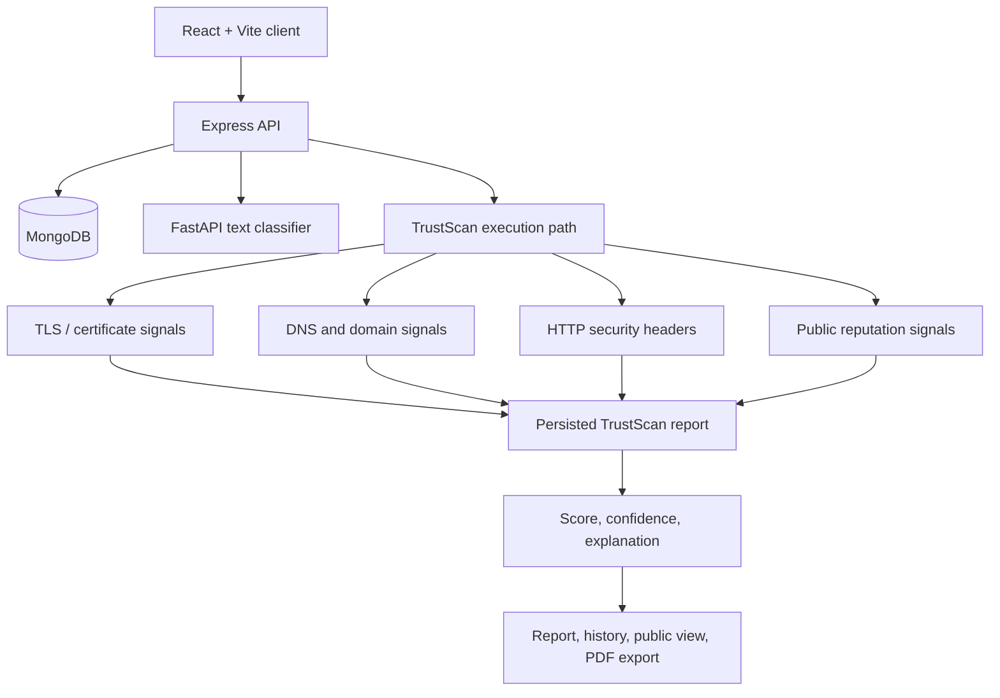

# CyberShield: From Scam Reports to Explainable Trust Signals

*A draft engineering book based on the public CyberShield repository.*

CyberShield combines community reporting and moderation with an AI-assisted text classifier and TrustScan, a passive URL-analysis workflow. The engineering story is not simply “a cybersecurity app”: it is the effort to make multiple services, evidence sources, and user-facing claims fit together without pretending that a score is certainty.

> **Evidence boundary:** This book reviews public source at [`740a612024491ecfb0df19f869a02be68d2f55b7`](https://github.com/Mystify7777/CyberShield/commit/740a612024491ecfb0df19f869a02be68d2f55b7). README and product documents describe intent; code and tests are used to check what is actually present. This documentation pass did not run tests, exercise the live services, or independently verify deployment health.

## Contents

1. [The product has more than one threat model](01-the-product-has-more-than-one-threat-model.md)
2. [A platform split across service boundaries](02-a-platform-split-across-service-boundaries.md)
3. [TrustScan: useful evidence without intrusive scanning](03-trustscan-useful-evidence-without-intrusive-scanning.md)
4. [A score is not a verdict from the universe](04-a-score-is-not-a-verdict-from-the-universe.md)
5. [Jobs, reports, and the promise of a finished result](05-jobs-reports-and-the-promise-of-a-finished-result.md)
6. [The AI service and the deployment seam](06-the-ai-service-and-the-deployment-seam.md)
7. [Security controls, tests, and what remains unproven](07-security-controls-tests-and-what-remains-unproven.md)
8. [Engineering decisions and chronology](engineering-decisions.md)

## System at a glance

The diagram summarizes the documented and implemented boundaries, not a claim that every integration is healthy in production. The dedicated TrustScan worker and Redis-backed queue described in architecture documents remain planned in the reviewed source.

## Review status

This is a **draft for review**, not a publication-ready claim set. In particular:

- The backend AI client reads `AI_SERVICE_URL`; the deployment must supply the correct reachable URL. A localhost value is suitable only for a matching local setup.
- PDF export is implemented client-side by rendering report content to a canvas and embedding that image in a PDF. This is not the same as a server-generated, text-searchable PDF.
- Route tests mock Mongo models and signal providers in the inspected suite. They support route-level behavior, not proof of live DNS/TLS/reputation availability or production report generation.
- The source README reports 55 backend tests passing, but this documentation pass did not rerun them.
- The keyword-based AI classifier is a small heuristic, not a trained general-purpose threat model.

## Primary source links

- [Source revision](https://github.com/Mystify7777/CyberShield/commit/740a612024491ecfb0df19f869a02be68d2f55b7)
- [System design](https://github.com/Mystify7777/CyberShield/blob/740a612024491ecfb0df19f869a02be68d2f55b7/docs/engineering/SYSTEM_DESIGN.md)
- [TrustScan architecture](https://github.com/Mystify7777/CyberShield/blob/740a612024491ecfb0df19f869a02be68d2f55b7/docs/engineering/TRUSTSCAN_ARCHITECTURE.md)
- [TrustScan product spec](https://github.com/Mystify7777/CyberShield/blob/740a612024491ecfb0df19f869a02be68d2f55b7/docs/product/TRUSTSCAN_PRODUCT_SPEC.md)
- [TrustScan policy](https://github.com/Mystify7777/CyberShield/blob/740a612024491ecfb0df19f869a02be68d2f55b7/docs/security/TRUSTSCAN_POLICY.md)
- [TrustScan scoring model](https://github.com/Mystify7777/CyberShield/blob/740a612024491ecfb0df19f869a02be68d2f55b7/docs/security/TRUSTSCAN_SCORING.md)
- [Testing strategy](https://github.com/Mystify7777/CyberShield/blob/740a612024491ecfb0df19f869a02be68d2f55b7/docs/ops/TESTING.md)
- [Deployment guide](https://github.com/Mystify7777/CyberShield/blob/740a612024491ecfb0df19f869a02be68d2f55b7/docs/ops/DEPLOYMENT.md)
