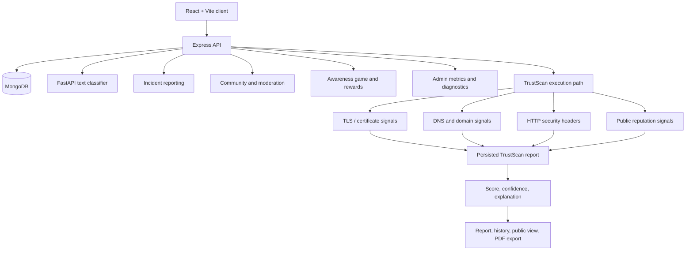

# CyberShield: From Scam Reports to Explainable Trust Signals

*A draft engineering book based on the public CyberShield repository.*

CyberShield is a multi-service cybersecurity awareness and trust platform. TrustScan is its newest technical centerpiece, but it is not the whole product. The platform also includes incident reporting, sensitive-report handling, AI-assisted scam triage, account verification and refresh-token sessions, knowledge articles, forum discussions, video and meme moderation, phishing-awareness games, XP/coins/badges, administrative governance, analytics, and client-error diagnostics.

The engineering story is about making these distinct workflows coexist: each has different inputs, trust boundaries, failure modes, and evidence requirements. A risk score is not certainty; a client-side success state is not a server-side guarantee; and a feature listed in a README is not proof that its deployed integration works.

> **Evidence boundary:** This book reviews public source at [revision `740a612024491ecfb0df19f869a02be68d2f55b7`](https://github.com/Mystify7777/CyberShield/commit/740a612024491ecfb0df19f869a02be68d2f55b7). README and product documents describe intent; code and tests are used to check what is actually present. This documentation pass did not run tests, exercise the live services, or independently verify deployment health. The repository remains unchanged.

## Contents

### Product and architecture

1. [The product has more than one threat model](01-the-product-has-more-than-one-threat-model.md)
2. [A platform split across service boundaries](02-a-platform-split-across-service-boundaries.md)

### TrustScan: the V3 centerpiece

3. [TrustScan: useful evidence without intrusive scanning](03-trustscan-useful-evidence-without-intrusive-scanning.md)
4. [A score is not a verdict from the universe](04-a-score-is-not-a-verdict-from-the-universe.md)
5. [Jobs, reports, and the promise of a finished result](05-jobs-reports-and-the-promise-of-a-finished-result.md)

### AI and the rest of the product

6. [The AI service and the deployment seam](06-the-ai-service-and-the-deployment-seam.md)
7. [Security controls, tests, and what remains unproven](07-security-controls-tests-and-what-remains-unproven.md)
8. [Incident reports are a workflow, not a form](08-incident-reporting-and-the-moderation-lifecycle.md)
9. [Authentication is a lifecycle](09-authentication-sessions-and-account-boundaries.md)
10. [Cybersecurity awareness needs governance](10-community-content-and-moderation.md)
11. [Rewards are business logic, not decoration](11-gamification-and-server-authoritative-rewards.md)
12. [Operating the platform requires visibility](12-admin-governance-analytics-and-observability.md)
13. [The product can be correct in one service and still fail](13-frontend-contracts-uploads-and-deployment-reality.md)
14. [Engineering decisions and chronology](engineering-decisions.md)

## System at a glance

The diagram shows the main product boundaries, not a claim that every integration is healthy in production. The dedicated TrustScan worker and Redis-backed queue described in architecture documents remain planned in the reviewed source.

## How to read the book

- **TrustScan** receives the deepest technical treatment because its signal collection, scoring, job lifecycle, and report artifacts are the current V3 focus.
- **The wider platform** is covered on its own terms: incident reports and privacy, account/session security, community moderation, game reward integrity, admin controls, analytics, uploads, and deployment seams.
- **Implementation and intention are separated.** Planned workers, queues, retries, and future product capabilities are not presented as implemented features.
- **Verification claims are bounded.** The source README reports 55 backend tests passing, but this documentation pass did not rerun them. Historical smoke failures are identified as historical, not as current production status.

## Review status

This remains a **draft for technical and editorial review**. Priority verification areas include:

- Verify backend-to-AI connectivity using the actual deployed `AI_SERVICE_URL`.
- Exercise TrustScan from URL submission through persistence, history, public sharing, and PDF export.
- Review report privacy and sensitive-field handling across public, personal, and admin endpoints.
- Test authentication refresh rotation, logout, password recovery, and role boundaries.
- Exercise upload validation and cleanup failures.
- Test server-authoritative game answers and reward updates under duplicate requests and partial failures.
- Compare the documented security hardening with current code and test results.
- Verify the live deployment separately from source-level behavior.

## Primary source links

- [Source revision](https://github.com/Mystify7777/CyberShield/commit/740a612024491ecfb0df19f869a02be68d2f55b7)
- [System design](https://github.com/Mystify7777/CyberShield/blob/740a612024491ecfb0df19f869a02be68d2f55b7/docs/engineering/SYSTEM_DESIGN.md)
- [API reference](https://github.com/Mystify7777/CyberShield/blob/740a612024491ecfb0df19f869a02be68d2f55b7/docs/engineering/API_REFERENCE.md)
- [Database schema](https://github.com/Mystify7777/CyberShield/blob/740a612024491ecfb0df19f869a02be68d2f55b7/docs/engineering/DB_SCHEMA.md)
- [Security guide](https://github.com/Mystify7777/CyberShield/blob/740a612024491ecfb0df19f869a02be68d2f55b7/docs/security/SECURITY.md)
- [TrustScan architecture](https://github.com/Mystify7777/CyberShield/blob/740a612024491ecfb0df19f869a02be68d2f55b7/docs/engineering/TRUSTSCAN_ARCHITECTURE.md)
- [TrustScan product spec](https://github.com/Mystify7777/CyberShield/blob/740a612024491ecfb0df19f869a02be68d2f55b7/docs/product/TRUSTSCAN_PRODUCT_SPEC.md)
- [Testing strategy](https://github.com/Mystify7777/CyberShield/blob/740a612024491ecfb0df19f869a02be68d2f55b7/docs/ops/TESTING.md)
- [Deployment guide](https://github.com/Mystify7777/CyberShield/blob/740a612024491ecfb0df19f869a02be68d2f55b7/docs/ops/DEPLOYMENT.md)
