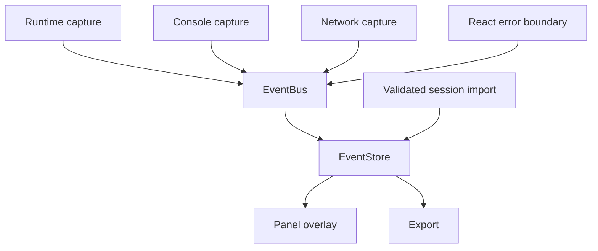

# DevLens: A Diagnostics Engine Where Capture and Presentation Stay Separate

*A chapter-based engineering book based on the public DevLens repository.*

DevLens is a framework-agnostic diagnostics engine for browser applications. It captures runtime errors, console activity, network outcomes, and React component errors, normalizes them into a shared event model, retains them in a bounded store, and presents them through a detachable overlay.

The important story is not the overlay alone. It is how the system keeps capture, event distribution, storage, and presentation separate while adding harder capabilities such as request lifecycle capture, sensitive URL redaction, React integration, event inspection, and safe session import.

> **Evidence boundary:** This book reviews public source at [revision `f9db916d6eed0c8804a76fe6ce07d0a8efb6b4ef`](https://github.com/Mystify7777/devlens/commit/f9db916d6eed0c8804a76fe6ce07d0a8efb6b4ef). It uses implementation files, tests, specifications, research notes, and accepted ADRs. It does not claim that tests or builds were executed during this documentation pass. Counts quoted from the README remain repository claims until independently rerun.

## Contents

1. [The overlay was never the whole product](01-the-overlay-was-never-the-whole-product.md)
2. [One event model, several capture sources](02-one-event-model-several-capture-sources.md)
3. [The EventBus is not the EventStore](03-the-eventbus-is-not-the-eventstore.md)
4. [Plugins must observe without owning the application](04-plugins-must-observe-without-owning-the-application.md)
5. [Network requests are operations with outcomes](05-network-requests-are-operations-with-outcomes.md)
6. [The Panel is a consumer, not a second engine](06-the-panel-is-a-consumer-not-a-second-engine.md)
7. [Inspection is a set of independent state transformations](07-inspection-is-a-set-of-independent-state-transformations.md)
8. [Importing a session means accepting untrusted history](08-importing-a-session-means-accepting-untrusted-history.md)
9. [React integration without making Core a React package](09-react-integration-without-making-core-a-react-package.md)
10. [Tests, ADRs, and the cost of changing contracts](10-tests-adrs-and-the-cost-of-changing-contracts.md)
11. [Engineering decisions and remaining limits](engineering-decisions.md)

## System at a glance

Capture packages report events. The EventBus normalizes and distributes them. The EventStore retains and queries them. The Panel displays the Store; export serializes its events; import validates previously exported events and inserts them directly into the Store while preserving historical identity.

## Core design rules

- **Engine first, UI second.** The Panel must not become the privileged owner of event data.
- **Everything is an event.** Capture sources use the shared `DevLensEvent` model.
- **Framework-agnostic by default.** Framework-specific integration lives outside Core.
- **Observe, do not interfere.** Capturing diagnostics must not suppress native console behavior or change the application's network request semantics.
- **Make lifecycle explicit.** Global hooks are installed and restored through idempotent lifecycle operations.
- **Preserve history deliberately.** Bounded retention, export, and import each have different semantics and constraints.
- **Treat external input as untrusted.** Imported JSON is validated completely before Store mutation.

## Review status and verification limits

This is a draft for technical review. The repository README reports 879 test cases and describes Core, Runtime, Console, Panel, Network, React, and the Playground as complete. This documentation pass did not run `pnpm test`, typecheck, build, or browser end-to-end scenarios. The test count and completion status are therefore attributed to the repository, not presented as freshly reproduced results.

Important verification areas include browser API restoration after plugin uninstall, preservation of native console behavior, Fetch/XHR edge cases, URL redaction, Shadow DOM isolation, imported-session rejection without partial mutation, and the current package/build/test state.

## Source trail

- [Pinned source revision](https://github.com/Mystify7777/devlens/commit/f9db916d6eed0c8804a76fe6ce07d0a8efb6b4ef)
- [README](https://github.com/Mystify7777/devlens/blob/f9db916d6eed0c8804a76fe6ce07d0a8efb6b4ef/README.md)
- [Engineering principles](https://github.com/Mystify7777/devlens/blob/f9db916d6eed0c8804a76fe6ce07d0a8efb6b4ef/DESIGN.md)
- [ADR index](https://github.com/Mystify7777/devlens/blob/f9db916d6eed0c8804a76fe6ce07d0a8efb6b4ef/docs/adr/README.md)
- [Inspection specification](https://github.com/Mystify7777/devlens/blob/f9db916d6eed0c8804a76fe6ce07d0a8efb6b4ef/docs/specs/inspection.md)
- [Session Import specification](https://github.com/Mystify7777/devlens/blob/f9db916d6eed0c8804a76fe6ce07d0a8efb6b4ef/docs/specs/session-import.md)
