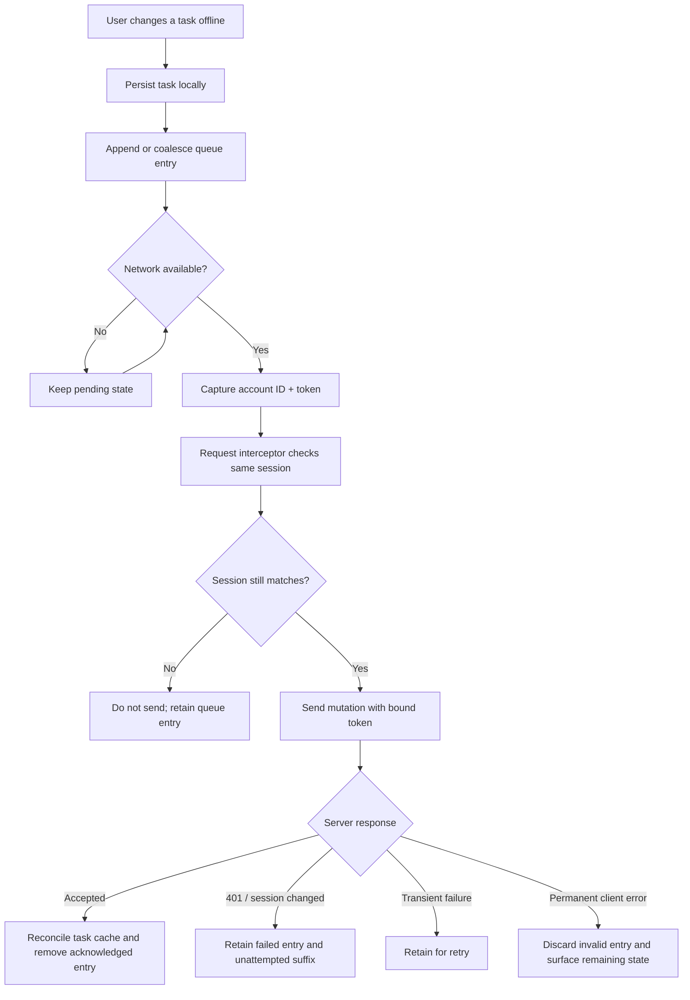

# Chapter 3: The Queue Is a Promise

Offline support is easy to advertise and difficult to make trustworthy. A button can remain enabled without a network connection; a local array can remember the user's edits. The real problem is what happens later, when those edits must become server mutations without being lost, needlessly duplicated, or sent in the wrong order.

HaloTask Pro represents pending operations as queue records. Each record has an identifier, an action type (create, update, or delete), an optional task ID and payload, and a creation timestamp. The queue lives in IndexedDB through the offline database wrapper, while the sync queue module owns its semantics. The database stores values; the queue decides how user intent is represented and compacted.

## A sequence of intent, not a pile of requests

A naive queue appends every click. If a user creates a task, edits its title three times, and then deletes it before reconnecting, replaying every intermediate operation is unnecessary. HaloTask Pro folds updates into a pending create or into an existing update for the same task. A delete removes related pending updates; if the task exists only as a queued create, that create can be removed too. Repeated deletes are coalesced.

This is more than an optimization. It makes the queue a representation of current intent rather than a transcript of intermediate states. The trade-off is that coalescing rules become correctness rules: operations must belong to the same task and account, and their combined meaning must remain valid.

The queue module serializes mutations through an operation chain. That reduces the risk of concurrent enqueue operations reading the same old queue and overwriting each other's changes. The action's owner is captured before waiting for the chain, so a user switch during that wait does not silently reassign the write.

## Replay is a state machine

The processor captures the current session before starting. It reads that account's queue, walks entries in order, and calls the task service with the captured session. A local create receives a server ID after a successful response; the processor remembers the mapping so a later queued update or delete can refer to the newly created task.

The processor classifies failures. A 401 is an authentication failure, not proof that the queued action is invalid. The entry and remaining suffix are retained for a later retry after authentication. A request refused because the session changed is also retained, and must not be sent under the new account. Permanent client errors in the 4xx range are discarded, except 401, 408, and 429. Other failures remain queued for a later attempt.

This makes the queue a small state machine. Successful entries leave the queue. Some entries are deferred because their local dependency has not yet been resolved. Authentication and session changes stop replay and preserve the unattempted suffix. Transient failures retain the failed entry.

The processor reports processed, failed, and remaining counts. In the current implementation, failed is set to the remaining queue length, so it is better understood as unresolved entries than as a count of every failure encountered in the run. The dashboard uses the remaining count to show an errors-pending state.

## The request can outlive the screen

The most consequential part of replay is the gap between deciding to send a request and the HTTP client constructing it. A check that the current user matches the queue owner is insufficient if the account can change before the request interceptor reads the token.

HaloTask Pro addresses this with a bound session containing both user ID and token. The processor passes that session to task-service calls. The API request interceptor checks that the current session still matches and applies the bound token in the same synchronous step. If the identity or token changed, it rejects the request before sending it.

The queue is therefore a promise with conditions: preserve intent, replay it only under the identity that created it, and treat server acknowledgement as completion. That is a more demanding contract than “retry when online.”

### Evidence trail

- [Queue model and coalescing rules](https://github.com/Mystify7777/Halotask-Pro/tree/e95ba08b107dcb0bd7e2941850bfb8246727b309/halotasks-client/src/offline/syncQueue.ts)
- [Queue replay and failure classification](https://github.com/Mystify7777/Halotask-Pro/tree/e95ba08b107dcb0bd7e2941850bfb8246727b309/halotasks-client/src/offline/queueProcessor.ts)
- [Bound session and request interceptor](https://github.com/Mystify7777/Halotask-Pro/tree/e95ba08b107dcb0bd7e2941850bfb8246727b309/halotasks-client/src/services/api.ts)
- [Queue behavior tests](https://github.com/Mystify7777/Halotask-Pro/tree/e95ba08b107dcb0bd7e2941850bfb8246727b309/halotasks-client/src/offline/syncQueue.test.ts)
- [Replay tests](https://github.com/Mystify7777/Halotask-Pro/tree/e95ba08b107dcb0bd7e2941850bfb8246727b309/halotasks-client/src/offline/queueProcessor.test.ts)
- [Request credential tests](https://github.com/Mystify7777/Halotask-Pro/tree/e95ba08b107dcb0bd7e2941850bfb8246727b309/halotasks-client/src/offline/queueProcessor.credentials.test.ts)

### What remains unproven here

The test files are evidence of intended edge cases, but this writing pass did not execute them. This review also did not establish exactly-once delivery for the ambiguous case where the server commits a mutation but the client never receives the response. That is a separate idempotency problem from keeping the queue attached to the correct user.
