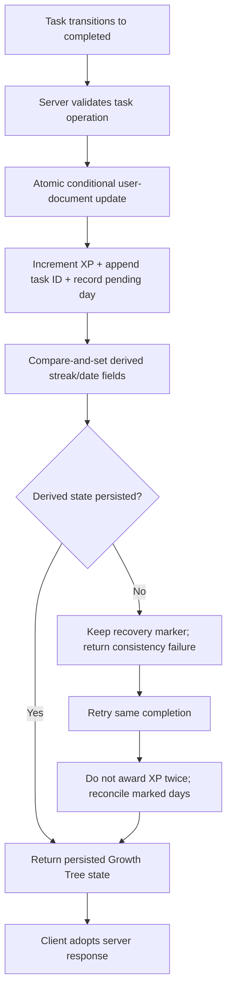

# Chapter 6: A Tree That Must Not Lie

The Growth Tree gives HaloTask Pro its most visible metaphor. Complete tasks, gain experience, develop a streak, and see a tree change over time. A visual reward can make progress tangible, but it introduces a difficult question: who is allowed to decide that progress happened?

The implementation assigns that authority to the server. Growth Tree storage describes the server as the durable source of truth for the current user's tree. IndexedDB holds a user-scoped copy so an offline start has something to display, but that local copy is a fallback, not a state the client pushes back to the server. When the server is reachable, initialization adopts the server tree as-is. Offline completions are described as an in-memory preview; the queued task mutation later asks the server to award progress, and the response replaces the preview.

That design rejects a tempting merge rule: “whichever device has more XP wins.” A higher local XP count might be stale, duplicated, or generated under assumptions the server has since rejected. Merging by maximum value would reward optimism, not necessarily correctness. Instead, the server computes awards and the client renders the result it receives.

## Completion is a domain operation

The task controller's completion path invokes server-side award logic and can include a Growth Tree result in the task response. Completing a task is therefore more than flipping a boolean. It is a domain operation with related consequences: persist completion, award progression according to server rules, and return the resulting state so the client can reconcile its display.

Server-side tree rules and award helpers live separately from the controller. The award helper first attempts one atomic conditional user-document update that increments XP and records the task ID in the award ledger. It then persists derived streak and date state with a compare-and-set. A pending-derived-days marker records awards whose XP/ledger write succeeded but whose derived-state write still needs recovery. If the second step fails, the helper throws a specific consistency error rather than returning an unpersisted projection; a retry can reconcile the recorded day without awarding the task twice.

The task-completion path and award helper are related but not one single database transaction: task state and user Growth Tree state live in separate documents. The controller's error paths and retry behavior matter because the award may be recorded before the task mutation is finished. The book therefore describes the documented and coded recovery protocol, not a blanket claim that every multi-document operation is atomic.

The offline queue connects this system to account isolation. When a queued create or update is replayed, the processor checks for a Growth Tree result and forwards it only if the original session is still active. It avoids applying a response from one account to the UI state of another account that signed in while the request was in flight.

## A metaphor with a consistency contract

The tree's emotional job is to make effort visible. Its engineering job is to avoid making a promise the rest of the system cannot support. A local animation can be immediate, but durable XP should follow a server-confirmed completion. The storage module describes ignoring a response whose XP is older than the current value, because bulk requests can finish out of order.

The source also describes a legacy migration boundary: unscoped tree records in IndexedDB or localStorage have no provable owner and are deleted rather than adopted. A motivational feature gets no exemption from data ownership rules just because its state looks harmless.

### Evidence trail

- [Growth Tree storage and authority model](https://github.com/Mystify7777/Halotask-Pro/tree/e95ba08b107dcb0bd7e2941850bfb8246727b309/halotasks-client/src/growth/treeStorage.ts)
- [Tree progression logic](https://github.com/Mystify7777/Halotask-Pro/tree/e95ba08b107dcb0bd7e2941850bfb8246727b309/halotasks-client/src/growth/treeLogic.ts)
- [Server award logic](https://github.com/Mystify7777/Halotask-Pro/tree/e95ba08b107dcb0bd7e2941850bfb8246727b309/halotasks-server/src/utils/treeAward.ts)
- [Server tree rules](https://github.com/Mystify7777/Halotask-Pro/tree/e95ba08b107dcb0bd7e2941850bfb8246727b309/halotasks-server/src/utils/treeRules.ts)
- [Tree rule tests](https://github.com/Mystify7777/Halotask-Pro/tree/e95ba08b107dcb0bd7e2941850bfb8246727b309/halotasks-server/tests/treeRules.test.ts)
- [Tree award tests](https://github.com/Mystify7777/Halotask-Pro/tree/e95ba08b107dcb0bd7e2941850bfb8246727b309/halotasks-server/tests/treeAward.test.ts)
- [Exact Mongoose award command tests](https://github.com/Mystify7777/Halotask-Pro/tree/e95ba08b107dcb0bd7e2941850bfb8246727b309/halotasks-server/tests/treeAward.mongoose.test.ts)
- [Development log for the server-authoritative award transition](https://github.com/Mystify7777/Halotask-Pro/tree/e95ba08b107dcb0bd7e2941850bfb8246727b309/docs/logs.md)

### What this design does not solve

The award helper's single-document XP/ledger update is atomic in MongoDB by design, and the derived-state path includes retry/recovery handling. Task records and the user tree are separate documents, however, and this review did not execute the concurrency or database-failure tests. The narrower supported claim is that the client adopts server-confirmed progression and the server contains explicit idempotency and recovery mechanisms; end-to-end production behavior remains to be verified.
