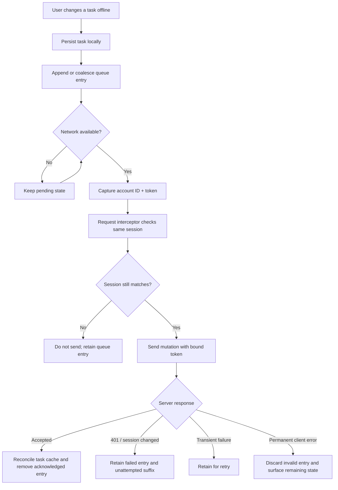
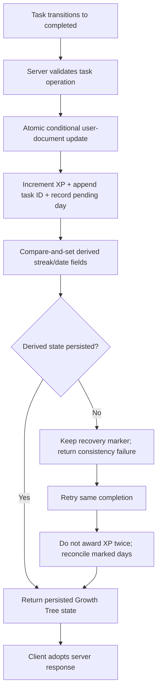

# HaloTask Pro: The Work Between Click and Consistency

*A chapter-based engineering narrative about building a productivity application that must remain useful when the network, session, or user's attention does not cooperate.*

HaloTask Pro began as a task manager, but its most interesting engineering questions sit beyond the task form. What happens when a user creates a task without a connection? What if the request succeeds but the response never arrives? What if the account changes while queued work is waiting? How can progress history remain coherent across devices?

This book follows the public repository's implementation, tests, documentation, and recorded development history. It is technical narrative, not a feature brochure: implemented behavior is distinguished from product claims, plans, and behavior that still needs production verification.

## Contents

1. [A Checklist Is the Easy Part](01-a-checklist-is-the-easy-part.md)
2. [Drawing the System's Boundaries](02-drawing-the-systems-boundaries.md)
3. [The Queue Is a Promise](03-the-queue-is-a-promise.md)
4. [An Account Is Part of the Data](04-an-account-is-part-of-the-data.md)
5. [Remembering What Was Finished](05-remembering-what-was-finished.md)
6. [A Tree That Must Not Lie](06-a-tree-that-must-not-lie.md)
7. [The Product Around the Task](07-the-product-around-the-task.md)
8. [Authentication Is More Than a Token](08-authentication-is-more-than-a-token.md)
9. [Tests as Executable Arguments](09-tests-as-executable-arguments.md)
10. [The Honest Edge of the System](10-the-honest-edge-of-the-system.md)

## Architecture at a glance

### Offline mutation lifecycle

### Growth Tree award lifecycle

## Reading notes

- **Reviewed source revision:** [`e95ba08b107dcb0bd7e2941850bfb8246727b309`](https://github.com/Mystify7777/Halotask-Pro/tree/e95ba08b107dcb0bd7e2941850bfb8246727b309). Technical evidence links inside this book are pinned to this revision where the exact implementation matters, so later changes do not silently alter the basis of the narrative.
- **Implementation evidence:** source and test files are linked from the chapters.
- **Documentation:** README and engineering notes describe intent and recorded decisions, but do not by themselves prove production behavior.
- **Verification boundary:** this edition is based on read-only source, test, changelog, and documentation review. No test suite was executed during this writing pass, and no production behavior was independently exercised.
- **Privacy:** this book intentionally excludes demo credentials and secrets.
- **Scope:** only the public repository is covered. No source files are modified by this documentation project.

## The central thread

The chapters follow one recurring problem: local intent must survive the gap between what a user does and what a server can confirm. The queue, account-scoped storage, server-authoritative history, Growth Tree, and session-bound requests are different responses to that same problem.

---

[Source repository](https://github.com/Mystify7777/Halotask-Pro) · [Back to the library](../../README.md)
